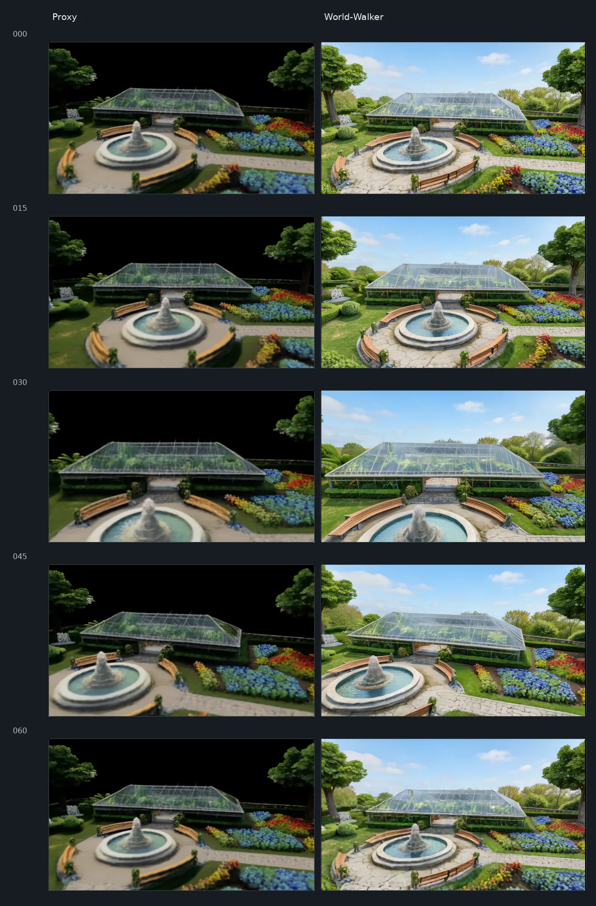

# World-Walker

World-Walker is a research pipeline that turns a natural-language scene description or a top-down layout into a camera-controlled video through explicit 3D proxy reconstruction and video refinement.

*Example output from a validated pipeline run. Rows show frames 000, 015, 030, 045, and 060; the historical run is not the P_RELEASE1 fresh-clone E2E.*

## Pipeline

~~~mermaid
flowchart TD
    P["Natural-language prompt"] --> A["Agent2Topdown"]
    A --> L["Generated layout"]
    I["Top-down image"] --> T["TripoSplat"]
    L --> F["FLUX.2 Klein refinement"]
    F --> V
    V --> T["TripoSplat"]
    T --> G["Gaussian 3D proxy"]
    G --> C["Automatic camera planning"]
    C --> R["Native 61-frame proxy video"]
    R --> X["FLUX endpoint refinement"]
    X --> Q["FixAnything temporal propagation"]
    Q --> O["Camera-controlled video"]
    O -. optional .-> S["SeedVR2 spatial super-resolution"]
~~~

World-Walker has two inputs: natural-language scene planning and a direct top-down image. Text mode generates a layout and refines it with FLUX.2 Klein, then pauses for a strict top-down visual review. Image mode starts from a supplied layout.

## Features

- Natural-language scene planning and direct top-down image input
- Feed-forward single-image Gaussian scene reconstruction
- Automatic low-altitude camera trajectory planning with collision checks
- Native 61-frame proxy compatible with the current FixAnything path
- FLUX clean-anchor refinement and endpoint alignment audit
- FixAnything temporal propagation
- Optional SeedVR2 super-resolution, disabled by default
- Stage-level caching, provenance manifests, and <code>--resume</code>
- Modular adapters for external repositories and stage-specific Python environments

The pipeline uses an explicit 3D proxy to guide camera-controlled video generation and is designed to improve scene-level spatial consistency. It does not guarantee exact geometry or long-range 3D consistency.

## Example

Input description: “A formal garden with a glass greenhouse, a central fountain, wooden benches, flower beds, stone paths, grass, shrubs, and surrounding trees.”

The teaser above compares five raw proxy frames with their FixAnything output from a validated historical run. It is a real pipeline example, not a claim about the P_RELEASE1 fresh-clone E2E.

## Quick start

### Install the orchestration package

~~~bash
git clone https://github.com/welshel/World-Walker.git
cd World-Walker
python3.10 -m venv .venv
. .venv/bin/activate
python -m pip install --upgrade pip
pip install -e .
cp .env.example .env
~~~

Configure external repositories, compatible stage-specific Python environments, model paths, and (for text mode) the API credential in your local <code>.env</code>. See [Installation](docs/installation.md). World-Walker does not download model weights automatically.

Check the selected input mode and required dependencies before inference:

~~~bash
python scripts/check_environment.py --config configs/default.yaml --mode image --output-dir outputs/environment_check
~~~

### Natural-language input

~~~bash
python -m pipeline.run_pipeline --scene-prompt "A formal garden with a glass greenhouse, fountain, benches, flower beds, stone paths, grass and surrounding trees." --config configs/default.yaml --output outputs/garden
~~~

Text mode pauses at <code>WAITING_VISUAL_REVIEW</code> after producing FLUX top-down candidates. Inspect the contact sheet and approve a strict nadir image before resuming; an unreviewed or hash-mismatched image cannot reach TripoSplat.

### Top-down image input

~~~bash
python -m pipeline.run_pipeline --input-topdown /path/to/layout.png --config configs/default.yaml --output outputs/garden
~~~

Continue an interrupted run with <code>--resume</code>. The pipeline reuses a stage only when its inputs, outputs, and relevant configuration fingerprint match.

## FLUX anchor alignment gate

The alignment audit is conservative and its metric thresholds are unchanged. <code>GOOD</code> continues. <code>PARTIAL</code> prints a warning and continues. <code>FAIL</code> stops the pipeline by default: it means the clean anchor differs from the proxy beyond the automatic threshold, not necessarily that FixAnything inference would fail.

Inspect the saved anchor/proxy comparison before overriding a failure. Experienced users can explicitly continue with:

~~~bash
python -m pipeline.run_pipeline --input-topdown /path/to/layout.png --config configs/default.yaml --output outputs/garden --allow-anchor-alignment-fail --resume
~~~

The opt-in config equivalent is:

~~~yaml
flux:
  anchor_alignment:
    allow_fail: true
~~~

An override prints:

> WARNING: 
> FLUX clean anchor failed automatic alignment audit. 
> Continuing because explicit override was enabled.

The reports record <code>ANCHOR_ALIGNMENT_OVERRIDE_USED</code>. A run completed after an alignment failure remains labeled <code>PARTIAL_ANCHOR_ALIGNMENT_OVERRIDE</code>; the override changes pipeline policy only, not the audit metric or its thresholds. Use this only after visually reviewing the comparison.

## Optional SeedVR2

SeedVR2 is an optional final spatial super-resolution stage and is disabled by default. It does not change the camera trajectory or scene geometry. Configure its separate repository, interpreter, and weights, then opt in:

~~~bash
python -m pipeline.run_pipeline --input-topdown /path/to/layout.png --config configs/default.yaml --output outputs/garden_hd --enable-seedvr2
~~~

## External components and model provenance

World-Walker does not redistribute external repositories or model weights. Current project records include:

- Agent2Topdown: bundled layout generation uses a user-configured DeepSeek API provider; its upstream repository URL is not verified in this release
- [TripoSplat](https://github.com/VAST-AI-Research/TripoSplat), at the verified reference commit listed in <code>configs/external_repos.example.yaml</code>
- [FLUX.2 Klein 4B](https://huggingface.co/black-forest-labs/FLUX.2-klein-4B), with local Distilled weights obtained from ModelScope; model revision is not pinned
- [DiffSynth-Studio](https://github.com/modelscope/DiffSynth-Studio), with the inspected local revision recorded in the external repository registry
- FixAnything/Wan and [Wan2.1](https://github.com/Wan-Video/Wan2.1); the inspected FixAnything checkout's upstream URL is not verified
- [SeedVR2](https://github.com/ByteDance-Seed/SeedVR2), an optional external stage

Check each component's current code and model terms before use or redistribution. Model access terms are separate from repository code licenses. See [third-party provenance](release_audit/third_party_licenses.md) and [installation details](docs/installation.md).

## Limitations

- Single-image reconstruction produces an approximate proxy; thin or complex structures can deform.
- Automatic camera planning depends on usable Gaussian geometry and can miss scene-specific composition needs.
- FLUX anchor editing can shift geometry, which is why endpoint alignment is audited.
- FixAnything propagates appearance over the current native 61-frame window; exact long-range 3D consistency is not guaranteed.
- SeedVR2 may improve spatial detail but does not repair geometry.
- Each external model and repository has independent environment, hardware, and licensing requirements.

## License

The project-level license is under review. No MIT, Apache, or other project license is claimed. Third-party components retain their respective terms; see [LICENSE_SELECTION_REQUIRED.md](LICENSE_SELECTION_REQUIRED.md).
